<div align="center">



# `m0x1` · Mohamed Abdrabou

### Cybersecurity Student · Aspiring SOC Analyst

<p>
  
  
</p>

<a href="https://www.linkedin.com/in/mohamed-ashraf-abdrabou">
  
</a>

</div>

---

<div align="center">

`[ ACCESS GRANTED ]` &nbsp; `➜` &nbsp; `[ INTRUSION DETECTED ]` &nbsp; `➜` &nbsp; `[ RESPONSE IN PROGRESS ]`

</div>

<p align="center">
  
</p>

## `> ABOUT_ME`

I'm studying **cybersecurity**, with a particular focus on becoming a **SOC Analyst**. I enjoy understanding how systems and networks work, spotting weaknesses, and helping defend environments against real-world threats.

```diff
+ Network security and information security
+ Security monitoring, detection, and incident response
+ Vulnerability research and responsible bug bounty hunting
+ SQL injection and PHP application security
+ SIEM: Wazuh, Splunk, and other security tools
```

## `> TOOLKIT`

<p align="center">
  
  
  
  
  
</p>

## `> CURRENT_MISSION`

```text
[>] Learn. Detect. Investigate. Defend.
[>] Build stronger SOC and threat-hunting skills.
[>] Find and responsibly report web security vulnerabilities.
```

<div align="center">

### `Stay curious. Think like an attacker. Defend like an analyst.`


<br />

<a href="https://www.linkedin.com/in/mohamed-ashraf-abdrabou">Let's connect on LinkedIn ↗</a>

</div>
